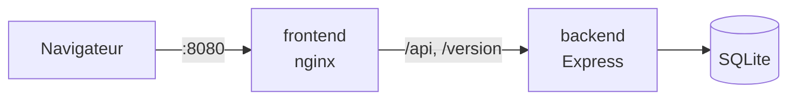

# Réservations de salles — projet fil rouge CI/CD

Application volontairement simple qui sert de support au module CI/CD : une API et une interface web pour **consulter, créer et annuler des réservations** de salles de formation.

L'objectif n'est pas l'application elle-même, mais tout ce qui l'entoure : tests, build, images Docker, pipeline, déploiement, supervision, mise à jour et rollback.



## Contenu du dépôt

```
.
├── backend/        API HTTP — Node.js 24, TypeScript, Express, SQLite
├── frontend/       Interface web — TypeScript, Vite, HTML/CSS, servie par nginx
├── docs/           Documentation pédagogique
├── compose.yaml    Lancement local de l'ensemble avec Docker Compose
└── README.md
```

Chaque application est autonome : elle a son propre `package.json` et ses tests. Une pipeline pourra donc les construire et les livrer séparément.

Le frontend est fourni avec son `Dockerfile`. Celui de l'API est à écrire : c'est l'objet du TP1, dont la consigne est disponible dans l'intranet de formation.

## Démarrage rapide

### Avec Docker Compose (après le TP1)

```bash
docker compose up --build
```

- Interface : http://localhost:8080
- API : http://localhost:3000/api/reservations

Pour simuler une nouvelle version :

```bash
APP_VERSION=1.1.0 docker compose up -d
```

Le bandeau en haut de l'interface change de numéro **et de couleur**.

### Sans Docker (fonctionne dès le départ)

Prérequis : Node.js 24 ou plus récent.

```bash
# Terminal 1 — API sur http://localhost:3000
cd backend
npm install
npm run dev

# Terminal 2 — interface sur http://localhost:5173
cd frontend
npm install
npm run dev
```

## Commandes utiles

| Dossier | Commande | Rôle |
|---|---|---|
| `backend` et `frontend` | `npm run lint` | Vérification des types TypeScript |
| `backend` et `frontend` | `npm test` | Tests automatisés (Vitest) |
| `backend` et `frontend` | `npm run build` | Build de production |
| `backend` | `npm run db:reset` | Réinitialise la base SQLite avec les données de démonstration |

## Configuration

| Variable | Application | Défaut | Rôle |
|---|---|---|---|
| `APP_VERSION` | backend, frontend | `0.0.0-local` | Version affichée par `/version` et dans l'interface |
| `GIT_COMMIT` | backend | `unknown` | Commit source, renvoyé par `/version` |
| `PORT` | backend | `3000` | Port d'écoute de l'API |
| `DATABASE_PATH` | backend | `./data/reservations.db` | Fichier SQLite |
| `API_URL` | frontend (conteneur) | `http://backend:3000` | Adresse de l'API relayée par nginx |

## Documentation

1. [Architecture](docs/01-architecture.md)
2. [Lancer le projet](docs/02-lancer-le-projet.md)
3. [Référence de l'API](docs/03-api.md)
4. [Santé et version](docs/04-sante-et-version.md)
5. [Pistes pour la chaîne CI/CD](docs/05-pistes-ci-cd.md)
