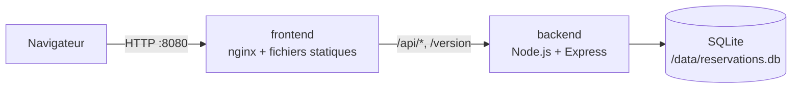

# 01 — Architecture

## Vue d'ensemble

| Composant | Technologie | Rôle |
|---|---|---|
| `frontend` | TypeScript, Vite, nginx | Sert l'interface et relaie les appels vers l'API |
| `backend` | Node.js 24, TypeScript, Express | Expose l'API HTTP, valide les données, applique les règles métier |
| Base de données | SQLite (module `node:sqlite` intégré à Node.js) | Stocke les réservations dans un fichier |

## Pourquoi une seule origine ?

Le navigateur n'appelle que le frontend (`localhost:8080`). nginx transmet ensuite `/api/*` et `/version` au backend. Ce choix évite de gérer le CORS et permet de changer l'adresse de l'API (`API_URL`) sans reconstruire l'interface. En développement, le serveur Vite joue le même rôle grâce à son proxy (`frontend/vite.config.ts`).

## Pourquoi SQLite ?

SQLite stocke toute la base dans un **fichier**. Aucun serveur de base de données n'est à installer, ce qui garde le projet simple. En contrepartie :

- le fichier doit être placé sur un **volume** pour survivre au remplacement du conteneur (voir le TP1) ;
- un seul processus doit écrire dans ce fichier : l'API ne peut pas être répliquée sur plusieurs conteneurs sans changer de base. C'est une limite à garder en tête lors du passage à Kubernetes.

## Organisation du backend

| Fichier | Responsabilité |
|---|---|
| `src/config.ts` | Lecture des variables d'environnement et valeurs de secours |
| `src/db.ts` | Ouverture de la base et création du schéma |
| `src/reservations.ts` | Validation des données et accès aux réservations |
| `src/seed.ts` | Données initiales, insérées si la base est vide |
| `src/app.ts` | Routes HTTP : santé, version, réservations |
| `src/server.ts` | Démarrage du serveur et arrêt propre sur `SIGTERM` |

`app.ts` ne démarre pas de serveur : il construit l'application à partir d'une base et d'une configuration. Les tests peuvent ainsi l'utiliser avec une base en mémoire, sans ouvrir de port.

## Organisation du frontend

| Fichier | Responsabilité |
|---|---|
| `index.html` | Structure de la page |
| `src/api.ts` | Appels HTTP vers l'API |
| `src/format.ts` | Fonctions pures de mise en forme, testées unitairement |
| `src/main.ts` | Affichage, formulaire et actions |
| `nginx/default.conf.template` | Configuration nginx générée au démarrage du conteneur |

## Modèle de données

| Champ | Type | Exemple |
|---|---|---|
| `id` | entier | `3` |
| `customerName` | texte | `Sophie Durand` |
| `email` | texte | `sophie.durand@example.com` |
| `room` | `Turing`, `Lovelace` ou `Hopper` | `Hopper` |
| `date` | `AAAA-MM-JJ` | `2030-01-12` |
| `startTime`, `endTime` | `HH:MM` | `09:30`, `11:00` |
| `participants` | entier | `4` |
| `status` | `confirmed` ou `cancelled` | `confirmed` |
| `createdAt` | date ISO | `2030-01-10T08:00:00Z` |

Une annulation ne supprime pas la ligne : elle passe le statut à `cancelled`, ce qui garde l'historique visible.
