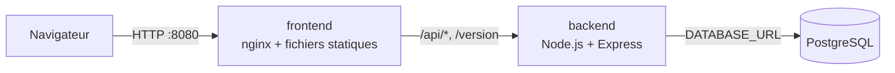

# 01 — Architecture

## Vue d'ensemble

| Composant | Technologie | Rôle |
|---|---|---|
| `frontend` | TypeScript, Vite, nginx | Sert l'interface et relaie les appels vers l'API |
| `backend` | Node.js 24, TypeScript, Express, driver `pg` | Expose l'API HTTP, valide les données, applique les règles métier |
| `db` | PostgreSQL 17 | Stocke les réservations |

## Pourquoi une seule origine ?

Le navigateur n'appelle que le frontend (`localhost:8080`). nginx transmet ensuite `/api/*` et `/version` au backend. Ce choix évite de gérer le CORS et permet de changer l'adresse de l'API (`API_URL`) sans reconstruire l'interface. En développement, le serveur Vite joue le même rôle grâce à son proxy (`frontend/vite.config.ts`).

## Une API sans état

Toutes les données sont dans PostgreSQL : l'API ne stocke rien localement. On peut donc remplacer un conteneur de l'API, ou en lancer plusieurs, sans perdre de données. C'est ce qui permettra plus tard la mise à jour progressive (rolling update) et la mise à l'échelle sur Kubernetes.

Seule la base a besoin d'un stockage persistant : un volume Docker en local (`db-data` dans `compose.yaml`), un volume persistant sur Kubernetes.

## Migrations

Le schéma de la base est décrit par des fichiers SQL numérotés dans `backend/migrations/`. Au démarrage, l'API applique dans l'ordre ceux qui ne l'ont pas encore été et les enregistre dans la table `schema_migrations`. Un verrou PostgreSQL empêche deux instances démarrées en même temps de migrer simultanément.

Règles à respecter :

- une migration déjà appliquée ne se modifie jamais : on en ajoute une nouvelle ;
- une migration doit rester compatible avec la version précédente de l'API, qui tourne encore pendant un déploiement progressif ou après un rollback.

Pour lancer les migrations séparément (par exemple avant un déploiement), utilisez `npm run db:migrate` et `MIGRATE_ON_START=false`.

## Organisation du backend

| Fichier | Responsabilité |
|---|---|
| `src/config.ts` | Lecture des variables d'environnement et valeurs de secours |
| `src/db.ts` | Pool de connexions, migrations, vérification de la base |
| `src/reservations.ts` | Validation des données et accès aux réservations |
| `src/seed.ts` | Données initiales, insérées si la base est vide |
| `src/app.ts` | Routes HTTP : santé, version, réservations |
| `src/server.ts` | Démarrage (migrations, données initiales, serveur) et arrêt propre sur `SIGTERM` |
| `migrations/*.sql` | Évolutions successives du schéma |

`app.ts` ne démarre pas de serveur : il construit l'application à partir d'une base et d'une configuration. Les tests l'utilisent ainsi sans ouvrir de port.

## Tests

| Fichier | Type | Base nécessaire |
|---|---|---|
| `test/validation.test.ts` | Unitaire : règles de validation | Non |
| `test/app.test.ts` | Intégration : routes HTTP et requêtes SQL | Oui (`DATABASE_URL`) |

Les tests d'intégration vident la base avant chaque test : utilisez une base dédiée, jamais une base contenant des données à conserver.

## Organisation du frontend

| Fichier | Responsabilité |
|---|---|
| `index.html` | Structure de la page |
| `src/api.ts` | Appels HTTP vers l'API |
| `src/format.ts` | Fonctions pures de mise en forme, testées unitairement |
| `src/main.ts` | Affichage, formulaire et actions |
| `nginx/default.conf.template` | Configuration nginx générée au démarrage du conteneur |

## Modèle de données

| Champ | Type | Exemple |
|---|---|---|
| `id` | entier | `3` |
| `customerName` | texte | `Sophie Durand` |
| `email` | texte | `sophie.durand@example.com` |
| `room` | `Turing`, `Lovelace` ou `Hopper` | `Hopper` |
| `date` | `AAAA-MM-JJ` | `2030-01-12` |
| `startTime`, `endTime` | `HH:MM` | `09:30`, `11:00` |
| `participants` | entier | `4` |
| `status` | `confirmed` ou `cancelled` | `confirmed` |
| `createdAt` | date ISO | `2030-01-10T08:00:00Z` |

Une annulation ne supprime pas la ligne : elle passe le statut à `cancelled`, ce qui garde l'historique visible.
