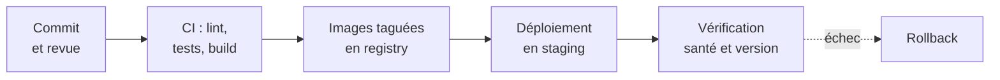

# 05 — Pistes pour la chaîne CI/CD

Ce document liste ce que la chaîne de livraison devra faire. Il ne donne pas de solution : c'est l'objet des TD.

## Cible

## Étape 1 — Intégration continue

Pour chaque application (`backend`, `frontend`), à chaque push et chaque demande de fusion :

1. installer les dépendances avec `npm ci` ;
2. vérifier les types avec `npm run lint` ;
3. lancer les tests avec `npm test` ;
4. construire avec `npm run build`.

Les tests de l'API ont besoin d'un PostgreSQL : la CI devra en fournir un.

Questions à se poser :

- Faut-il reconstruire le frontend quand seul le backend a changé ?
- Comment rendre le cache des dépendances efficace ?
- Que doit-il se passer quand un test échoue ?

## Étape 2 — Images versionnées

- Construire les deux images **une seule fois** par commit.
- Les taguer avec une valeur traçable (SHA du commit, numéro de version), jamais uniquement `latest`.
- Passer la même valeur en `--build-arg APP_VERSION` et `GIT_COMMIT` pour que `/version` corresponde au tag.
- Publier les images dans un registry uniquement si toutes les vérifications sont passées.

## Étape 3 — Déploiement en staging

- Déployer les images publiées, sans les reconstruire.
- Brancher les sondes : `livenessProbe` sur `/health/live`, `readinessProbe` sur `/health/ready` (API) et `/healthz` (frontend).
- Déployer PostgreSQL avec un volume persistant, et fournir ses identifiants à l'API par un secret.
- Décider où appliquer les migrations : au démarrage de l'API ou dans une tâche dédiée avant le déploiement.

## Étape 4 — Vérification après déploiement

- Attendre la fin du rollout.
- Appeler `/version` et vérifier que la version attendue est bien en ligne.
- Faire un test de fonctionnement minimal : lister les réservations.

## Étape 5 — Rollback

- Revenir à l'image précédente, déjà présente dans le registry.
- Vérifier le retour à l'ancienne version dans le bandeau et sur `/version`.

## Pour aller plus loin

- Ajouter un linter (ESLint) et un contrôle de formatage.
- Analyser les dépendances et les images à la recherche de vulnérabilités.
- Mesurer la durée de la pipeline et chercher à la réduire.
- Introduire volontairement une régression et vérifier qu'elle est bloquée.
