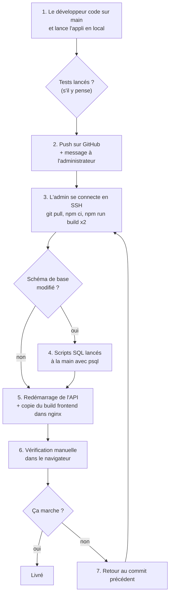

# Parcours de livraison actuel

Ce document décrit comment l'équipe livre aujourd'hui l'application sur le serveur de l'école, et ce que le module CI/CD devra automatiser.

## Schéma du parcours

## Étapes du parcours

| # | Étape | Qui | Manuelle / auto | Durée estimée | Risques |
|---|-------|-----|-----------------|---------------|---------|
| 1 | Coder sur `main`, lancer l'appli, tests « s'il y pense » | Développeur | Manuelle | 1 h à 1 jour (codage) + 1 à 2 min (tests) | Tests oubliés ; code non vérifié poussé directement sur `main` ; « ça marche sur ma machine » |
| 2 | Pousser sur GitHub et prévenir l'administrateur par message | Développeur | Manuelle | 2 min | Message oublié, perdu ou mal compris ; administrateur indisponible ; aucune trace de ce qui a été demandé en livraison |
| 3 | SSH, `git pull`, `npm ci` et `npm run build` dans les deux applications | Administrateur | Manuelle | 5 à 10 min | Build sur le serveur, donc dans un environnement différent (version de Node, dépendances) ; ni lint ni tests ; erreur de frappe ou mauvais dossier |
| 4 | Exécuter les scripts SQL avec `psql` si le schéma a changé | Administrateur | Manuelle | 2 à 10 min | Script oublié, joué dans le mauvais ordre ou deux fois ; pas de suivi des migrations appliquées ; pas de retour arrière |
| 5 | Redémarrer l'API et copier le build du frontend dans nginx | Administrateur | Manuelle | 2 à 5 min | Coupure de service pendant le redémarrage ; copie incomplète ; frontend et API de versions différentes |
| 6 | Ouvrir l'application dans le navigateur | Administrateur | Manuelle | 2 min | Contrôle superficiel (la page s'affiche, mais l'API et la base ?) ; ni `/health/ready` ni `/version` vérifiés ; non reproductible |
| 7 | Rollback : revenir au commit précédent et refaire les étapes 3 à 6 | Administrateur | Manuelle | 15 à 25 min | Lent, donc long temps d'indisponibilité ; le rebuild peut échouer à son tour ; une migration SQL déjà jouée n'est pas annulée |

Au total, une livraison mobilise une personne supplémentaire et prend de 15 à 30 minutes si tout va bien, davantage en cas de retour arrière. Aucune étape n'est automatique : le résultat dépend de la rigueur de chacun.

## Les trois améliorations prioritaires

1. **Mettre en place une intégration continue sur chaque push et chaque demande de fusion** (`npm ci`, `lint`, `test`, `build` pour le backend et le frontend, avec un PostgreSQL de service), puis protéger `main` pour qu'aucun code ne soit fusionné sans CI verte. C'est la racine du problème : aujourd'hui rien ne force à vérifier le code avant de livrer (étapes 1 et 3). Elle est aussi la moins coûteuse à mettre en place et la plus rentable, car elle détecte les erreurs avant qu'elles n'atteignent le serveur.

2. **Construire une seule fois des artefacts versionnés (images Docker taguées avec le SHA du commit) et déployer ces artefacts sans rien reconstruire sur le serveur.** Cela supprime le `git pull`, les `npm ci` et `npm run build` faits à la main sur le serveur, et la copie dans nginx (étapes 3 et 5). Ce qui a été testé est exactement ce qui est livré, et la version affichée dans `/version` correspond au tag déployé. Les migrations, que l'API sait déjà appliquer au démarrage, remplacent aussi les scripts `psql` manuels (étape 4).

3. **Vérifier automatiquement le déploiement et revenir à la version précédente en cas d'échec.** Après chaque déploiement, on attend la fin du rollout, on interroge `/health/ready` et `/version`, puis on teste une requête simple sur l'API. En cas d'échec, on redéploie l'image précédente, déjà présente dans le registry, au lieu de reconstruire (étapes 6 et 7). Le retour arrière passe de plusieurs dizaines de minutes à quelques secondes, et la vérification ne dépend plus d'un coup d'œil dans le navigateur.

L'ordre compte : la CI donne la confiance dans le code, les artefacts versionnés donnent la confiance dans ce qui est livré, et la vérification suivie du rollback donnent la confiance dans ce qui tourne.
